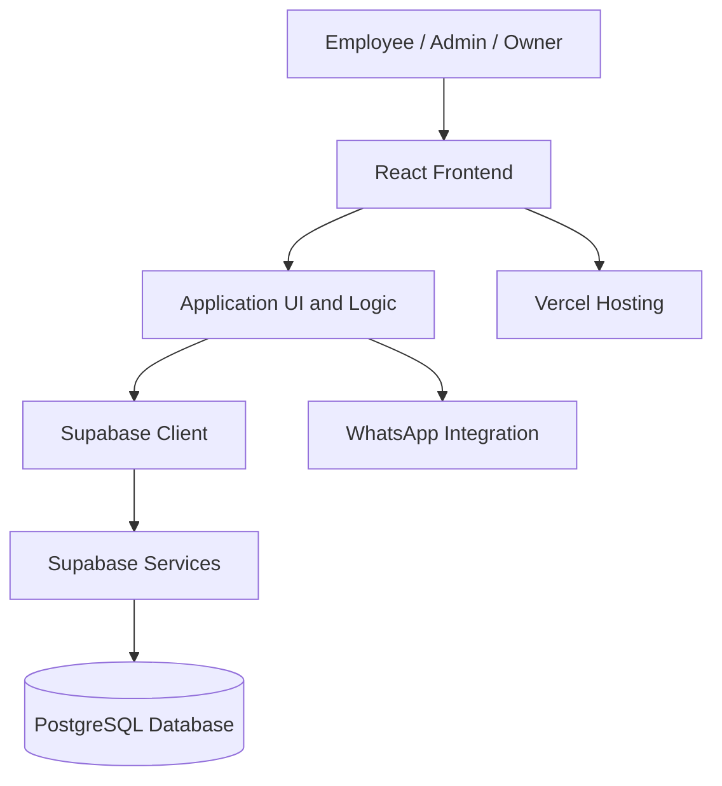
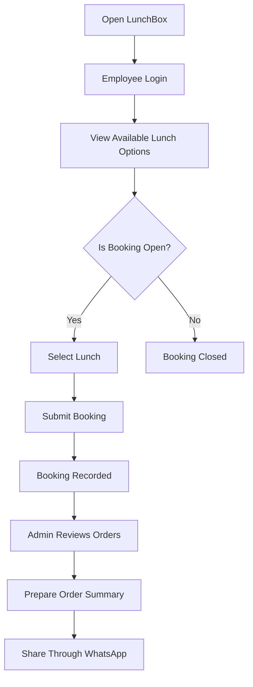
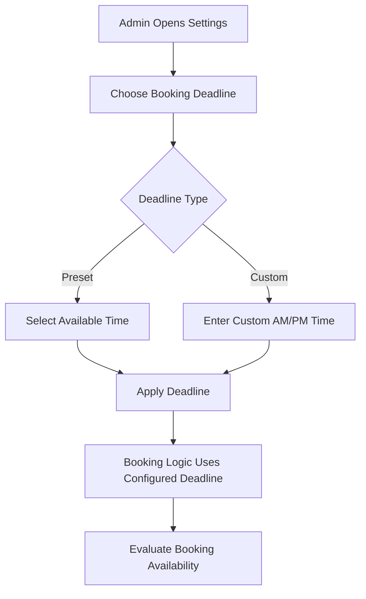

<div align="center">

# 🍱 LunchBox — Office Food Ordering System

### A smarter, simpler way to manage daily office lunch.

A modern web application designed to simplify daily lunch bookings, manage employee orders, and streamline office lunch coordination.

**Built for Sparsh CCTV, Panipat**


**Simple Booking · Flexible Deadlines · Order Management · WhatsApp Integration**

</div>

---

## 📑 Table of Contents

- [🌟 About the Project](#-about-the-project)
- [🎯 Project Objectives](#-project-objectives)
- [✨ Features](#-features)
- [⏰ Booking Deadline Management](#-booking-deadline-management)
- [👥 User Roles](#-user-roles)
- [🍽️ Employee Experience](#-employee-experience)
- [🛡️ Admin Dashboard](#-admin-dashboard)
- [📱 WhatsApp Integration](#-whatsapp-integration)
- [🎨 UI and User Experience](#-ui-and-user-experience)
- [🧰 Technology Stack](#-technology-stack)
- [🏗️ Application Architecture](#-application-architecture)
- [🔄 Application Workflow](#-application-workflow)
- [📁 Project Structure](#-project-structure)
- [🚀 Getting Started](#-getting-started)
- [🔐 Environment Variables](#-environment-variables)
- [🗄️ Supabase Configuration](#️-supabase-configuration)
- [🌐 Deployment](#-deployment)
- [🔀 Git and GitHub Workflow](#-git-and-github-workflow)
- [🧪 Testing Checklist](#-testing-checklist)
- [🔒 Security Considerations](#-security-considerations)
- [💡 Future Improvements](#-future-improvements)
- [👨‍💻 Project Purpose](#-project-purpose)

---

## 🌟 About the Project

**LunchBox** is a web-based office lunch ordering application built to simplify the daily process of collecting, managing, and coordinating employee lunch orders.

Traditional lunch management often involves manually collecting orders through messages, maintaining spreadsheets, and repeatedly confirming employee preferences. LunchBox brings this process into a centralized web application.

Employees can book their lunch, administrators can manage daily orders, and the application provides a convenient way to review consolidated order information.

The application combines a modern frontend, cloud-backed data storage, administrative controls, and WhatsApp integration to support everyday office operations.

### 🎯 The Problem

Manual lunch management can create several challenges:

- Repeated messages and unnecessary communication.
- Incorrect or missing lunch orders.
- Difficulty tracking employee bookings.
- Confusion when employees need to change their orders.
- Last-minute booking requests.
- Time-consuming preparation of daily order summaries.

### 💡 The Solution

LunchBox provides a centralized platform where employees can book lunch and authorized administrators can manage the process.

The application aims to make daily lunch coordination more organized, efficient, and convenient.

---

## 🎯 Project Objectives

The primary objectives of LunchBox are:

- Simplify daily office lunch booking.
- Centralize employee lunch orders.
- Provide a configurable booking deadline.
- Allow administrators to manage booking availability.
- Support an organized order-edit approval workflow.
- Provide consolidated order information.
- Integrate WhatsApp into the order-sharing process.
- Improve the employee and administrator experience.
- Provide a responsive interface for different screen sizes.
- Reduce repetitive manual work.

---

## ✨ Features

| Feature | Description |
|---|---|
| 👤 Employee Login | Provides the employee login flow supported by the application. |
| 🍱 Lunch Booking | Allows employees to select and book their lunch. |
| ⏰ Flexible Booking Deadline | Supports configurable daily booking cut-off times. |
| 🕒 Preset Deadline Options | Provides predefined deadline choices for administrators. |
| ⚙️ Custom Deadline | Supports a custom booking time with AM/PM selection. |
| 🛡️ Admin Dashboard | Provides administrative controls for lunch management. |
| 📋 Order Management | Displays and manages employee lunch bookings. |
| ✏️ Edit Requests | Supports requests to modify existing orders. |
| ✅ Edit Approval | Allows administrators to review and approve supported order changes. |
| 🍽️ Menu Management | Supports management of available lunch options. |
| 🥡 Surplus Management | Includes a workflow for surplus food management. |
| 📱 WhatsApp Integration | Supports preparing and sharing lunch order information. |
| 📊 Order Summary | Provides a consolidated view of lunch bookings. |
| 🎨 Modern Interface | Uses modern frontend styling and reusable components. |
| ✨ UI Animations | Uses Framer Motion where animations are implemented. |
| 📱 Responsive Design | Designed for desktop and mobile use. |
| ☁️ Cloud Backend | Uses Supabase for configured backend services. |
| 🚀 Deployment | Supports frontend hosting through Vercel. |

---

## ⏰ Booking Deadline Management

The **Booking Deadline** feature allows authorized administrators to control when employees must finish booking their lunch.

The default booking deadline is **11:30 AM**.

Administrators can select a predefined time or configure a custom deadline according to office requirements.

### 🕒 Available Booking Deadlines

| Option | Deadline |
|---|---|
| Default | **11:30 AM** |
| Preset 1 | 12:00 PM |
| Preset 2 | 12:30 PM |
| Preset 3 | 1:00 PM |
| Preset 4 | 1:30 PM |
| Preset 5 | 2:00 PM |
| Custom Time | Administrator-defined time with AM/PM selection |

### ⚙️ How It Works

1. The default booking deadline is set to **11:30 AM**.
2. An authorized administrator opens the relevant booking or settings interface.
3. The administrator selects one of the predefined deadline options or chooses the custom-time option.
4. For a custom deadline, the administrator specifies the desired time, including AM or PM.
5. The application uses the configured deadline to determine booking availability.
6. Employees can submit bookings while booking is open and other booking requirements are satisfied.
7. Once the configured deadline has passed, new bookings should be prevented according to the application's implemented rules.

### 📌 Example

Suppose the office wants employees to finish booking lunch before 12:30 PM.

The administrator selects:

**Booking Deadline → 12:30 PM**

The application then uses the configured deadline according to its booking rules.

If the office later requires a different cut-off time, the administrator can select another preset or configure a custom time.

### 🌟 Benefits

- Provides flexibility for different office requirements.
- Reduces confusion about the daily booking cut-off.
- Makes deadline management easier for administrators.
- Supports predefined and custom time options.
- Helps organize daily lunch operations.

### 🧪 Booking Deadline Scenarios

| Scenario | Expected Behavior |
|---|---|
| No custom deadline is configured | The default deadline is 11:30 AM. |
| Administrator selects 12:00 PM | The configured deadline becomes 12:00 PM. |
| Administrator selects 12:30 PM | The configured deadline becomes 12:30 PM. |
| Administrator selects 1:00 PM | The configured deadline becomes 1:00 PM. |
| Administrator selects 1:30 PM | The configured deadline becomes 1:30 PM. |
| Administrator selects 2:00 PM | The configured deadline becomes 2:00 PM. |
| Administrator selects a custom AM time | The selected AM time is interpreted correctly. |
| Administrator selects a custom PM time | The selected PM time is interpreted correctly. |
| Employee books before the deadline | Booking is allowed when all other conditions are satisfied. |
| Employee tries to book after the deadline | Booking is rejected when the deadline restriction applies. |
| Application is refreshed | The configured deadline remains consistent if persistence is implemented. |
| Administrator changes the deadline | The application follows the updated deadline according to its rules. |

> **Important:** These are the documented requirements for the feature. The actual enforcement, persistence, and time-zone behavior should be verified against the application implementation.

---

## 👥 User Roles

LunchBox supports employee and administrative workflows.

### 👤 Employee

Employees can use the application to:

- Access the employee interface.
- View available lunch options.
- Book lunch for the relevant date.
- Review their booking information.
- Submit supported order-edit requests.
- Participate in the surplus food workflow where available.

### 🛡️ Admin / Owner

Authorized administrators can use the application to:

- Access the administrative dashboard.
- Review employee lunch bookings.
- Manage available lunch options.
- Configure booking deadlines.
- Review order-edit requests.
- Manage supported surplus food operations.
- View consolidated order information.
- Prepare lunch order summaries for communication.

Available permissions depend on the application's implemented authorization rules.

---

## 🍽️ Employee Experience

The employee interface is designed to make daily lunch booking straightforward.

### Typical Employee Journey

1. Open the LunchBox application.
2. Enter the required employee login information.
3. View the available lunch options.
4. Select the desired lunch.
5. Submit the booking while booking is open.
6. Review the booking information.
7. Submit an edit request if changes are supported and needed.

### User Experience Goals

- Keep the booking process simple.
- Make important information easy to find.
- Provide clear feedback after user actions.
- Reduce unnecessary navigation.
- Maintain usability across desktop and mobile screens.

---

## 🛡️ Admin Dashboard

The administrative dashboard provides a centralized interface for managing lunch operations.

### 📊 Order Management

Administrators can review available lunch bookings and inspect consolidated order information.

### 🍽️ Menu Management

The application supports menu-related management through its existing interface.

The available operations depend on the implemented menu-management workflow.

### ⏰ Booking Deadline Settings

Administrators can configure the daily booking cut-off by selecting a preset or entering a custom time.

The supported deadline options are:

- 11:30 AM by default.
- 12:00 PM.
- 12:30 PM.
- 1:00 PM.
- 1:30 PM.
- 2:00 PM.
- Custom AM/PM time.

### ✏️ Order-Edit Requests

The application supports a workflow for reviewing order-edit requests.

A typical workflow is:

1. An employee submits an edit request.
2. The request becomes available for administrative review.
3. An administrator reviews the requested changes.
4. The administrator approves or rejects the request using the available controls.
5. An approved request updates the relevant order according to the application's implementation.

The consolidated order summary should reflect the latest approved order data.

### 🥡 Surplus Food Management

The application includes a surplus-related workflow intended to help manage available surplus food.

The exact process depends on the implemented features.

### 📱 WhatsApp Order Summary

Administrators can use the application's WhatsApp integration to prepare or share lunch order information.

The recipient and prepared message should be checked before operational use.

---

## 📱 WhatsApp Integration

WhatsApp integration supports communication around daily lunch orders.

The application can prepare order information for sharing through the supported WhatsApp workflow.

### Benefits

- Simplifies the preparation of lunch summaries.
- Reduces repetitive manual copying.
- Makes consolidated order information easier to share.
- Supports an existing office communication channel.

### Important Considerations

- Verify the WhatsApp recipient.
- Check that the summary contains the correct order information.
- Ensure approved edits are reflected in the summary.
- Avoid sharing unnecessary employee information.
- Verify the integration on supported desktop and mobile environments.

> Opening WhatsApp with a prepared message is not the same as automatically sending that message. The actual behavior depends on the implementation.

---

## 🎨 UI and User Experience

LunchBox follows a modern frontend approach focused on clarity, consistency, and usability.

### Design Principles

- Clear visual hierarchy.
- Consistent spacing and typography.
- Responsive layouts.
- Reusable UI components.
- Understandable forms and controls.
- Clear success and error feedback.
- Consistent styling across employee and administrator interfaces.

### ✨ Animations and Interactions

Framer Motion is included in the frontend technology stack.

Where implemented, animations can improve the interface through:

- Smooth component transitions.
- Animated entry and exit effects.
- Subtle interaction feedback.
- More natural visual state changes.

Animations should remain lightweight and should not interfere with accessibility or usability.

### 📱 Responsive Design

The application is designed to support different screen sizes, including:

- Desktop computers.
- Laptops.
- Tablets.
- Mobile phones.

Booking controls, order information, and administrative actions should remain easy to use across supported devices.

---

## 🧰 Technology Stack

LunchBox uses a modern JavaScript frontend with cloud-backed application services.

| Technology | Purpose |
|---|---|
| React | Building reusable user-interface components. |
| Vite | Frontend development server and build tooling. |
| JavaScript | Application logic and interactions. |
| Tailwind CSS | Utility-based styling and responsive layouts. |
| Framer Motion | Animations and transitions where implemented. |
| Lucide React | Icons and interface elements. |
| Supabase | Configured backend services and database integration. |
| PostgreSQL | Relational database used by Supabase. |
| Vercel | Frontend hosting and deployment. |
| WhatsApp | Order communication through the supported integration. |
| Git | Source-code version control. |
| GitHub | Repository hosting and collaboration. |

### Frontend

The frontend is responsible for:

- Rendering employee and administrative interfaces.
- Handling user interactions.
- Displaying menus and bookings.
- Managing application state.
- Communicating with Supabase.
- Displaying success and error feedback.

### Backend Services

Supabase provides the backend services configured for the application, which may include database access, authentication-related services, persistent application data, and access policies.

### Hosting

Vercel hosts the deployed frontend application.

The deployed application depends on the correct environment configuration and Supabase setup.

---

## 🏗️ Application Architecture

The application follows a frontend-to-backend architecture.



### Architecture Overview

**React Frontend**

Displays the user interface and handles user interactions.

**Application Logic**

Coordinates booking actions, order management, administrative workflows, and interface state.

**Supabase Client**

Connects the frontend to the configured Supabase services.

**Supabase and PostgreSQL**

Provide backend services and persistent storage according to the project's configuration.

**WhatsApp Integration**

Supports the configured order-sharing workflow.

**Vercel**

Hosts the deployed frontend application.

> This is a high-level architecture diagram. The exact implementation depends on the project's source code and backend configuration.

---

## 🔄 Application Workflow

### Daily Lunch Booking



### Booking Deadline Configuration



These diagrams illustrate the intended workflows and should be kept aligned with the actual application behavior.

---

## 📁 Project Structure

A simplified example of the project structure is shown below.

```text
lunchbox-main/
│
├── public/
│
├── src/
│   ├── components/
│   │   ├── admin/
│   │   └── ...
│   │
│   ├── context/
│   ├── data/
│   ├── lib/
│   ├── utils/
│   ├── App.jsx
│   ├── main.jsx
│   └── ...
│
├── .env
├── .gitignore
├── index.html
├── package.json
├── package-lock.json
├── vite.config.js
└── README.md
```

> This is an illustrative structure, not a verified inventory of every file in the repository. Preserve the existing project structure.

### Directory Responsibilities

| Directory | Purpose |
|---|---|
| `src/components/` | Reusable interface components. |
| `src/components/admin/` | Administrative interface components. |
| `src/context/` | Shared application state and context logic. |
| `src/data/` | Application data and default configuration. |
| `src/lib/` | Shared libraries and external-service clients. |
| `src/utils/` | Helper functions and validation logic. |
| `public/` | Static assets served by the frontend. |

---

## 🚀 Getting Started

Follow these steps to run the project locally.

### Prerequisites

Make sure you have:

- Node.js installed.
- npm available.
- Git installed.
- Access to the project repository.
- A configured Supabase project.

### 1. Open the Project Directory

On Ubuntu, open a terminal and run:

```bash
cd /home/mohit/Documents/lunchbox-main
```

Make sure this is the original LunchBox project directory.

### 2. Install Dependencies

Run:

```bash
npm install
```

This installs the dependencies defined in `package.json`.

### 3. Configure Environment Variables

Create or update the `.env` file in the project root.

Use the variable names expected by the existing application.

See the [Environment Variables](#-environment-variables) section.

### 4. Start the Development Server

Run:

```bash
npm run dev
```

Vite will display the local development URL in the terminal.

Open the displayed URL in your browser.

For example:

```text
http://localhost:5173
```

The actual port may differ depending on the project configuration or port availability.

### 5. Build for Production

Run:

```bash
npm run build
```

This creates the production build using the configured build process.

### 6. Preview the Production Build

Run:

```bash
npm run preview
```

Open the local URL printed in the terminal to inspect the production build.

---

## 🔐 Environment Variables

The application uses environment variables to configure its Supabase connection and public application URL.

The following variables have been used by this project:

```dotenv
VITE_APP_URL=https://your-app-domain.example
VITE_SUPABASE_URL=https://your-project.supabase.co
VITE_SUPABASE_PUBLISHABLE_KEY=your-supabase-publishable-key
```

Replace the example values with the appropriate values for your environment.

### `VITE_APP_URL`

The public URL of the application.

This can be used by features that need to generate links to the application, such as QR codes.

For local development, use the local application URL when required by the relevant feature.

For production, use the deployed application URL.

### `VITE_SUPABASE_URL`

The URL of the Supabase project.

You can find it in your Supabase project settings.

### `VITE_SUPABASE_PUBLISHABLE_KEY`

The publishable key used by the frontend Supabase client.

Use the key type supported by the existing application configuration.

### ⚠️ Environment Variable Security

- Do not commit your private `.env` file to GitHub.
- Never place database passwords in frontend environment variables.
- Never expose a Supabase service-role key in browser-side code.
- Remember that Vite variables prefixed with `VITE_` are included in the client-side application bundle.
- Configure appropriate Supabase Row Level Security (RLS) policies.
- Keep sensitive backend credentials in secure server-side environments.

---

## 🗄️ Supabase Configuration

Supabase provides the configured backend services for LunchBox.

### Configuration Steps

1. Open the Supabase dashboard.
2. Select the appropriate project.
3. Locate the project URL and supported publishable key.
4. Add the required values to the application's environment configuration.
5. Confirm that the required database objects and access policies exist.
6. Run the application locally.
7. Test employee and administrative workflows.

### Database Considerations

Before changing database structures:

- Review the existing schema.
- Confirm which tables the application uses.
- Check the relevant Row Level Security policies.
- Verify relationships and constraints.
- Back up important data before making structural changes.

Database changes should be based on the actual implementation and requirements rather than assumptions.

---

## 🌐 Deployment

LunchBox can be deployed to Vercel.

### 1. Prepare the Project

From the project directory, run:

```bash
npm run build
```

Resolve build errors before deploying.

### 2. Push Changes to GitHub

Commit and push the required application changes to the appropriate repository and branch.

See the [Git and GitHub Workflow](#-git-and-github-workflow) section.

### 3. Import the Repository into Vercel

1. Open Vercel.
2. Import the GitHub repository.
3. Select the correct project root.
4. Confirm the build settings.
5. Configure the required environment variables.

### 4. Configure Production Environment Variables

Configure the production values for:

- `VITE_APP_URL`
- `VITE_SUPABASE_URL`
- `VITE_SUPABASE_PUBLISHABLE_KEY`

Use the correct values for the production environment.

### 5. Deploy

Start the deployment and wait for the build to finish.

Open the deployed application and test the main workflows.

### 6. Verify Production Behavior

After deployment, test:

- Employee login.
- Lunch booking.
- Booking deadline enforcement.
- Administrative access.
- Order summaries.
- Order-edit requests and approvals.
- WhatsApp integration.
- Mobile responsiveness.
- Supabase connectivity.

> Environment variable changes may require a new deployment before updated values become available to the frontend.

---

## 🔀 Git and GitHub Workflow

Git tracks source-code changes, while GitHub hosts the repository.

### Check the Current Branch and Changes

Check the working tree:

```bash
git status
```

Check the current branch:

```bash
git branch --show-current
```

Review recent commits:

```bash
git log -5 --oneline
```

### Stage the README

From the project directory, run:

```bash
git add README.md
```

### Commit the Changes

Run:

```bash
git commit -m "docs: improve LunchBox README and booking deadline"
```

### Push to GitHub

Run:

```bash
git push
```

If the branch does not have an upstream configured, Git will indicate the command needed to configure it.

### Good Git Practices

- Check the active branch before committing.
- Review `git status` before staging changes.
- Never commit credentials or private environment files.
- Avoid force-pushing unless you understand the consequences.
- Use descriptive commit messages.
- Keep documentation consistent with the application.

---

## 🧪 Testing Checklist

Use this checklist when validating the application after changes.

### 👤 Employee Workflow

- [ ] Employee can access the application.
- [ ] Employee login validation works.
- [ ] Available lunch options are displayed correctly.
- [ ] Employee can submit a booking when booking is open.
- [ ] Booking information is displayed correctly.
- [ ] Invalid input produces clear feedback.
- [ ] The interface works on mobile devices.

### ⏰ Booking Deadline

- [ ] Default deadline is 11:30 AM.
- [ ] The 12:00 PM preset can be selected.
- [ ] The 12:30 PM preset can be selected.
- [ ] The 1:00 PM preset can be selected.
- [ ] The 1:30 PM preset can be selected.
- [ ] The 2:00 PM preset can be selected.
- [ ] Custom-time selection is available.
- [ ] Custom AM times are interpreted correctly.
- [ ] Custom PM times are interpreted correctly.
- [ ] Booking is allowed before the deadline when other conditions permit.
- [ ] Booking is rejected after the deadline when the restriction applies.
- [ ] The deadline persists according to the application's design.
- [ ] Updating the deadline produces the expected behavior.
- [ ] Date changes and time-zone behavior are handled correctly.

### 🛡️ Admin Dashboard

- [ ] Authorized administrators can access the dashboard.
- [ ] Unauthorized users cannot access restricted actions.
- [ ] Current bookings are displayed correctly.
- [ ] Menu-related controls work as expected.
- [ ] Booking deadlines can be configured.
- [ ] Order-edit requests appear for review.
- [ ] Approved edits update the intended order.
- [ ] The order summary reflects the latest approved order data.
- [ ] Surplus-related workflows work as expected.

### 📱 WhatsApp Integration

- [ ] The correct WhatsApp destination is used.
- [ ] The prepared message contains the correct order information.
- [ ] Special characters and line breaks display correctly.
- [ ] The summary reflects approved order changes.
- [ ] The workflow works on supported devices.

### 🗄️ Backend and Data

- [ ] Supabase connection works.
- [ ] Required database objects exist.
- [ ] Data changes persist correctly.
- [ ] RLS policies protect restricted data.
- [ ] Unauthorized operations are rejected.
- [ ] Private credentials are not exposed in the frontend bundle.

### 🚀 Production Deployment

- [ ] Production build completes successfully.
- [ ] Vercel deployment completes successfully.
- [ ] Production environment variables are configured.
- [ ] The deployed application loads correctly.
- [ ] Booking and deadline behavior work in production.
- [ ] Mobile layouts remain usable.
- [ ] Browser console errors are investigated.

---

## 🔒 Security Considerations

Security matters because LunchBox handles employee information and office order data.

### Environment Variables

Never commit private credentials or sensitive configuration to a public repository.

### Supabase Access Policies

Configure Row Level Security and authorization policies so users can access only the data and operations permitted by the application's security model.

### Role-Based Access

Administrative operations should be restricted to authorized users.

Hiding a button in the frontend is not sufficient security by itself.

### Input Validation

Validate important input values and enforce the relevant rules in the appropriate application layer.

### Booking Deadline Enforcement

Booking restrictions should be enforced by the application's booking logic, not only by a visual countdown or disabled button.

Where backend enforcement is used, apply a consistent time source and appropriate time-zone rules.

### Data Integrity

Approved order edits should update the intended order consistently.

The consolidated order summary should reflect the latest approved order data.

---

## 💡 Future Improvements

Potential improvements for future versions include:

- 📊 More detailed lunch-order analytics.
- 📅 Historical booking reports.
- 🔔 Booking deadline reminders.
- 📈 Administrative reporting dashboards.
- 🧾 Exportable order summaries.
- 📱 Further mobile usability improvements.
- ♿ Accessibility improvements.
- 🧪 Automated tests for booking and deadline rules.
- 🔐 Additional security and authorization testing.
- ⚡ Performance improvements.
- 🕒 More explicit time-zone handling.

These are potential improvements, not claims that the features are already implemented.

---

## 👨‍💻 Project Purpose

LunchBox was created to improve the daily office lunch-booking process through a centralized web application.

The project brings together frontend development, application state management, database integration, administrative workflows, and deployment practices in a practical business use case.

It demonstrates how a modern web application can reduce manual coordination and make recurring office tasks easier to manage.

### Core Principles

- Simplicity.
- Usability.
- Reliability.
- Maintainability.
- Responsive design.
- Secure data access.
- Practical automation.

---

<div align="center">

### 🍱 LunchBox

**Making everyday office lunch management simpler.**

Built with ❤️ using React, Vite, Tailwind CSS, and Supabase.

</div>
